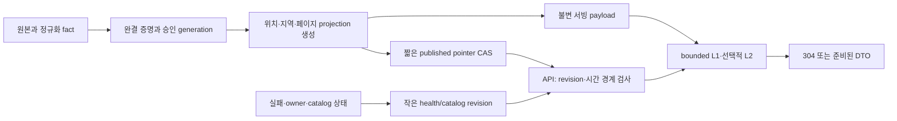

# Weather 조회 성능 극대화 검토 및 3회 개선 기록

## 범위와 진행 상태

사용자는 잠금 최소화·캐시·인덱스·MV·비정규화를 포함한 모든 방안의 적극적인 검토와, 원인 발굴→개선→전후 측정·회귀 검증을 3회 반복하도록 요청했다. Weather 3회 완료 뒤 Transport도 같은 과정을 3회 진행한다. 이 문서의 제안은 아직 구현·운영 수용 완료를 뜻하지 않는다. 실제 회차별 결과를 아래에 추가한다.

기준 제품은 PR207을 통합한 `3a4ae3fa6b6057add487deaeea030cc26a3501ac`, PostgreSQL18.6/schema0037이다. 키·접속 문자열·원천 payload·운영 SQL 원문을 기록하지 않는다. 검토 중 운영 변경·수집 취소·삭제·prune는 실행하지 않았다.

## 확인한 병목

2026-11-07 08:05UTC 읽기 전용 관측과 기존 배포 증거를 사용했다. 표의 용량은 물리 크기이며 행 수·dead tuple은 통계 추정이다. 인덱스 크기를 전부 bloat로 해석하지 않는다.

| 관측 | 실제 결과 | 해석 한계 |
| --- | --- | --- |
| 실제 current export | 최초 statement_timeout/503, 별도 후속200 약27.1초 | 단일 표본이며 p95·cold·인과 비교 아님 |
| 일간 export 실패 로그 | guard timeout3건·statement timeout1건 | API 시작 뒤 최근5000줄의 관측, 전체 장애율 아님 |
| 현재값 projection | 약902만 행, heap2.70GB·인덱스19.47GB | 추정902만; UPDATE 약5215만·HOT0의 누적 관측 |
| snapshot | 약37행이지만 총23.3MB, heap8KB | JSON/TOAST를 반복 해석할 때 작은 행 수만으로 싸다고 판단 불가 |
| 승인 inventory | 실제7561행 | current 첫 구성과 마지막 health에서 같은 선택 함수를 다시 호출 |
| 호스트 | 4CPU·약7.5GiB RAM, load약14.8 | Weather 단독 부하로 귀속 불가 |
| 별도 vmstat 두 1초 표본 | CPU idle0%, run queue19·12, I/O wait0% | 짧은 표본이며 지속 포화의 장기 통계 아님 |
| 저장소 | artifact는 실제 NVMe/ext4 | 과거 eMMC 원인 설명을 현재 사실로 재사용하지 않음 |
| DB 관측 도구 | pg_stat_statements 미설치·track_io_timing OFF | SQL별 누적 시간·I/O 원인은 아직 관측 한계 |

DB의 `n_live_tup=1`인 catalog는 실제1451행이고 `pg_class.reltuples=1450`이다. 이를 catalog 통계 부재·데이터1개로 잘못 판정하지 않는다.

### 격리 재현: 304도 비싼 전체 조회다

제품 코드를 바꾸지 않고 자체 Docker PostgreSQL18과 WSL Python3.13에서 기존 실제 회귀 시나리오 3개에 계측을 붙였다. 최종3개 통과. 초기 계측 스크립트의 import 경로와 None header 처리 실패는 도구 실패이며 제품 회귀 실패가 아니다. 두 원문도 보존했다.

| 합성 작은 fixture의 요청 | SELECT | 쓰기 | 승인 선택 | 파일 읽기 |
| --- | ---: | --- | ---: | ---: |
| 전체 원천 current200 | 36 | INSERT2 | 2회 | 9회 |
| 같은 current304 | 36 | UPDATE1 | 2회 | 9회 |
| location reference304 | 4 | UPDATE1 | 0회 | 0회, 그러나 공유 guard 보유 |
| 일간304 | 27 | UPDATE1 | 별도 coverage 검사 | 0회, 그러나 공유 guard 보유 |

작은 fixture의 304 wall 약62ms를 운영 예상치로 환산하지 않는다. 구조적으로 조건부 요청이 DB·파일 처리 뒤 판정되고, 재사용 handle의15분 TTL이 요청마다 UPDATE되며, metadata→health 전체가 최대2 reader 슬롯과 SH guard 안에 있다는 사실을 확인했다.

## 우선순위와 검토한 방안

| 방안 | 판단 | 구체적 조건·이유 |
| --- | --- | --- |
| 승인 시점의 서빙 projection·불변 페이지 사전 생성 | 최우선 구조 후보 | 요청마다 원천 벡터·DTO·정렬을 재구성하지 않고 작은 revision 포인터를 읽는다. 원본·정규화 fact·승인 authority와 분리한다. |
| 조기 ETag/응답 캐시 | 최우선 후보 | 본문 계산 전 data/catalog/health revision과 시간 경계를 확인해야 한다. 실패·원천 침묵·특보 만료에도 ETag/상태가 바뀌어야 한다. |
| L1 bounded cache·동일 키 계산 합치기 | 우선 후보 | immutable digest·schema version·정규화된 filter를 키로 사용하고 byte 상한·동시 miss 한 번 계산을 둔다. |
| Redis/L2 | 조건부 | 여러 프로세스/호스트가 같은 계산을 반복할 때 이득. 현재4CPU 호스트에 새 상시 프로세스부터 추가하는 것은 우선순위가 낮다. 버전 키와 TTL을 함께 사용한다. |
| 전역 파일 guard 축소 | 우선 구조 후보 | DB 조회·JSON 파싱까지 SH를 붙잡지 않는다. 먼저 세대 pin/lease·retirement와 cursor 보존을 설계하고 무결성·유실 거절 계약을 검증한다. 잠금 파일 삭제나 guard 무조건 제거는 하지 않는다. |
| MVCC 기반 짧은 publication CAS | 우선 구조 후보 | staging payload는 비공개로 준비하고 마지막 pointer만 원자 교체한다. 행 잠금까지 전혀 없다는 뜻은 아니다. |
| snapshot의 작은 selection 컬럼과 복합 인덱스 | 우선 작은 변경 후보 | location용 stored selection_kind는 이미 있다. current signature·forecast selection·daily_resource의 JSON 조건과 큰 manifest 분리를 검토한다. |
| owner·cohort·건강도 projection | 우선 구조 후보 | 매 요청 수천 scope의 mutable 상태를 조립하는 대신 실패/owner 변경을 반영하는 작은 health revision을 제공한다. 최초 미승인/유실을 정상으로 바꾸지 않는다. |
| index 통합·축소 | 적극 검토 | 사용0인 current projection 인덱스가 약6.97GB 있으나 관측 기간·fallback·generic/custom plan을 검증한 뒤 후보별 판정한다. PK/unique는 보존한다. |
| covering/partial index | 선별 | 이미 marker용 partial/covering 인덱스가 있다. wide JSON INCLUDE·유사 인덱스 추가는 쓰기 비용을 키운다. 높은 update 빈도에서는 visibility map/HOT도 확인한다. |
| 확장 통계·plan 안정성 | 조건부 | provider/dataset/style/metric 상관관계의 추정 오류가 확인될 때 사용한다. generic plan과 prepared 반복도 함께 측정한다. |
| 원천 JSONB 전면 변경·GIN | 낮음 | point 조회·정렬·승인 JOIN 문제를 일반 GIN이 해결하지 않는다. 실제 자주 쓰는 scalar만 정식 projection으로 꺼낸다. |
| 비정규화 current/detail/region projection | 우선 구조 후보 | 승인 시점에 위치별 현재·시간별·행정구역 대표값을 준비한다. 모든 provider/filter 조합을 무제한 생성하지 않는다. source lineage와 원본은 그대로 둔다. |
| PostgreSQL MV | 일/지역/주 단위 분석에 선별 | 자주 바뀌는 current 전체에 full refresh를 반복하는 용도로는 후순위. 기존 daily summaries는 이미 증분 사전 계산 표이므로 중복 MV부터 만들지 않는다. |
| 증분 집계 표·outbox | 우선 후보 | 변경된 source/location만 반영하고 실패 시 같은 버전으로 재시도한다. Redis invalidation보다 DB commit을 정본으로 삼는다. |
| 파티셔닝·BRIN | 이력·retention에 선별 | fact는 이미 시간 파티션이다. 현재9백만 projection의 관측/예보·기간 분리를 검토하되 실제 필터와 pruning 증거가 있어야 한다. |
| Timescale/pg_ivm | 낮음/후속 | 현재 확장이 없다. 추가 설치·쓰기 경로 변경보다 기존 증분 projector를 먼저 개선한다. |
| read replica·별도 서빙 호스트 | 용량 단계 후보 | 읽기/수집의 CPU·I/O를 분리할 수 있다. replica lag·승인 watermark·파일 세대 정합을 함께 다룬다. |
| connection pool·PgBouncer·async | 조건부 | 현재 단일 순간 DB active1/idle9였고 pool10+overflow10이 있다. pool/worker 수부터 늘리면4CPU 포화가 심해질 수 있다. 인증·상태·무거운 export의 admission은 분리한다. |
| DB 메모리/진공/JIT 조정 | 측정 뒤 | work_mem16MB는 연산·동시 실행마다 곱해진다. temp 누적35GB만으로 전역 상향하지 않는다. fillfactor만으로 indexed column 갱신의 HOT0이 해결되지 않는다. |
| HTTP private 캐시·브라우저 SWR | 우선 후보 | no-store 일괄 정책을 경로별로 분리한다. 세션/권한은 유지하고 provider·kind·지역·날짜별 키, logout 폐기, 재검증을 둔다. |
| CDN·reverse proxy cache | 공개 파생 데이터에 조건부 | 인증된 서비스/관리 데이터를 공용 캐시에 섞지 않는다. 캐시해도 권한·원천 실패·24시간 침묵·특보 유효기간을 지킨다. |
| 초기 DTO 축소·압축·페이지 구조 | 우선 후보 | raw metadata 없는 지도 전용 응답, 지역 대표값/viewport API·시간별 묶음·gzip 사전 생성. 이미 marker60×동시2·취소·뷰포트 한정은 구현돼 있으므로 재구현하지 않는다. |
| timeout/동시성 단순 상향 | 채택하지 않음 | 일을 적게 하는 개선 없이 대기·메모리·CPU 경쟁만 늘린다. |

## 권장 목표 구조

필터/제공처·schema·catalog·data·health revision을 캐시 identity로 묶는다. 24시간 침묵, source_max_age, 값 만료, 예보 target 경과, 날짜 전환, 특보 valid_until은 이벤트가 없어도 상태가 바뀌므로 valid_until에서 재평가한다. 실패/유실503을 성공 빈 집합으로 캐시하지 않는다. source freshness와 캐시 생성 시각을 혼동하지 않는다.

GET304가 기존 next_cursor를 재사용한다면 그 cursor의 유효15분 lease도 보장해야 한다. TTL 갱신을 무조건 삭제하지 않고 갱신 임계값·새 handle 발급·lease 검증을 함께 설계한다. 파일 검증 캐시는 content hash+수명 보호를 전제로 하며 파일 유실/변조 시험을 통과하기 전 guard를 제거하지 않는다. GC/prune OFF 정책은 별도 게이트 전까지 유지한다.

## 세 회차의 선택과 검증 원칙

1. 실제 단계별 profile로 가장 비싼 반복 연산을 선택하고, 최소 변경의 전후 동등성·SQL/파일/잠금 횟수·시간을 측정한다.
2. 첫 결과 뒤 남은 상위 병목을 새로 측정해 개선한다. 첫 가설을 확인하기 위해 유리한 요청만 고르지 않는다.
3. 캐시·동시 요청·cursor·실패/침묵·원천 갱신을 포함한 재측정으로 남은 병목을 개선하고 최종 배포 수용을 수행한다.

지연 목표는 구현 뒤 검증할 기준이며 현재 달성 수치가 아니다: warm304 서버p95 30ms, 준비된 첫 페이지p95 150ms, 지도/상세p95 250ms, cold 준비 payload 조회p95 1초를 초기 목표로 둔다. 대용량 전체 다운로드 전송시간과 WAN 지연은 별도다. 동시1/2/4/8/16과 평시 수집 병행 조건을 분리한다. 프로세스 재시작은 cache cold와 동일하지 않고 OS/DB 캐시를 운영에서 비우지 않는다.

전후 검증은 DTO 의미·순서·페이지/cursor·ETag의 실패 반영·최초 미승인·원본/hash/lineage 보존을 포함한다. 합성 fixture 배율을 운영 보장으로 환산하지 않는다. 별도 원문은 Git 밖 `C:/Users/digit/.codex/tmp/weather-read-max-review-20261107/`에 보존한다.

## 근거 문서

- [PostgreSQL18 MVCC](https://www.postgresql.org/docs/18/mvcc-intro.html): 일반 읽기와 쓰기의 snapshot 수명·동시성.
- [MV refresh](https://www.postgresql.org/docs/18/sql-refreshmaterializedview.html): full refresh와 concurrent refresh의 UNIQUE 인덱스·단일 refresh 조건.
- [Index-only scan](https://www.postgresql.org/docs/18/indexes-index-only-scans.html): visibility map·INCLUDE의 효과와 비용.
- [확장 통계](https://www.postgresql.org/docs/18/sql-createstatistics.html): 상관관계·표현식의 추정 개선 범위.
- [리소스 설정](https://www.postgresql.org/docs/18/runtime-config-resource.html): shared_buffers와 OS 캐시·동시 메모리 비용.
- [pg_stat_statements](https://www.postgresql.org/docs/18/pgstatstatements.html): SQL별 관측과 preload/재시작 필요 조건. 이번 검토에서 설치·재시작하지 않았다.
- [Redis client-side caching](https://redis.io/docs/latest/develop/reference/client-side-caching/): 로컬 캐시·무효화. Redis 도입 자체를 선행 조건으로 두지 않는다.
- [HTTP caching RFC9111](https://www.rfc-editor.org/rfc/rfc9111): 인증 응답의 캐시 범위·재검증.

## 실제 개선 회차 결과

### Weather 1회차 — 확정 항목 전체 구현·검증 중

첫 inventory→generation JOIN의 실제5초 timeout과 뒤이은 owner JOIN timeout을 각각 배치 조회로 바꿨다. 두 배치 변경 뒤 별도 읽기 전용 후보는1451위치/3306scope를 끝까지 선택했다. owner epoch·native run·cohort·plan 존재 검증은 유지했다. 첫 후보 성공은 전체 지연 목표 달성과 다르다. 추가 관측의 cold 선택18.31초·같은 프로세스 warm13.38초는 여전히 느리며, 포화된 공용 호스트의 서로 다른 시각 단발 관측을 배율 개선으로 환산하지 않는다. 그 관측의 cold SQL 목록은 도구의 공유 리스트 때문에 warm 목록으로 덮인 계측 오류가 있어 SQL별 cold 비교에는 사용하지 않는다. 원문은 보존한다.

TTL은 새 요청 뒤 최소15분을 유지하는 분 경계 값으로 만들고, 충분한 수명이 남으면 UPDATE를 생략한다. 위치·일별 요약 page는 파일을 읽지 않으므로 DB MVCC를 사용하고 파일 reader 두 슬롯에서는 분리한다. 실제 파일을 읽는 current/forecast/mid와 요약 reducer는 guard를 유지한다.

현재/예보/일별 snapshot 선택의 JSON 조건은5개 작은 저장 생성 열과3개 선택 인덱스로 옮긴다. 0038 migration은 원문을 수정하지 않고 한 ALTER로 backfill하며 lock 최대5초·statement 최대180초와 더 짧은 기존 제한을 지킨다. 기존 정의가 다르면 거부하고 같은 정의로 완료된 단계는 재사용한다. `weather_current_values`의 idx_scan0 인덱스는 불필요함이 입증되지 않아 삭제하지 않는다.

불변 descriptor는 실제 roster 내용 hash로 해석 결과만 기억한다. 파일은 요청마다 같은 fd의 크기/hash/count와 존재를 확인한 뒤 JSON 해석 결과를 재사용하며 호출자의 변경은 격리한다. 첫 캐시 구현의 깊은 복사가 합성5000point에서 기존13.24ms보다19.67ms로 느린 것을 발견했다. 평탄한 canonical point는 독립 dict 복사를 쓰는 후보가3.43ms였으므로 이 경로를 채택한 최종 재검증은 기존12.89ms·수정4.54ms였다. 이 합성 관측을 운영 p95로 사용하지 않는다.

작은 fixture의 같은304 요청 계수:

|항목|수정 전|현재 후보|
|---|---:|---:|
|current UPDATE|1|0|
|locations UPDATE|1|0|
|daily UPDATE|1|0|
|locations 파일 SH 보유|있음|0|
|daily 파일 SH 보유|있음|0|
|all-source current SELECT|36|40|
|all-source current 파일 읽기|9|9|

배치는 SQL 문장 수를 줄이는 변경이 아니라 큰 JOIN timeout을 없애기 위한 변경이다. source 건강도는 아직 요청당 두 번 대조하므로 current304의 전면 재계산은 남아 있다. 파일 읽기 생략을 캐시 성공으로 꾸미지 않는다. 다음 회차는 이 남은 비용을 실제 갱신·실패 감지와 함께 줄이는 구조를 조사한다.

WSL 집중189개, 후속58개, 계측3개는 각각 통과했다. 겹치는 시험을 합산하지 않는다. Docker 집중243개와 최종 캐시·전체 migration 경로20개가 통과했다. 마지막20개는 WSL에서도 통과했으며 앞선 묶음과 중복된다. Ruff·diff 검사·Alembic 단일 head0038 확인도 통과했다. 운영 반영은 진행 중이다. 현재 운영은 기존 제품3a4ae3f/DB0037이다. Weather2·3 및 Transport1·2·3은 미착수다.

### 1회차 운영 반영의 실제 중간 상태

제품674d6f8의 ARM64 API481f5478·수집기14a8764c를 실제 빌드하고 native 계약을 확인했다. 첫 배포 d2569852는 migration 자식1/부모1·Main0·cgroup 부재·최초 Invocation failed로 종료했다. API/수집기 교체 전에 멈췄다. 실제 DB에는5개 생성 열과 첫 signature 인덱스의 invalid/ready 상태가 남았고 revision은0037이었다. 첫 SQLSTATE는 수집되지 않아 원인을 단정하지 않는다.

격리 PG18에서 실제55P03로 같은 invalid 상태를 만들고, 기존 RR reader를 유지한 채 해당 인덱스만 일반 REINDEX하고 나머지2개를 같은 bounded SHARE transaction에서 생성하는 경로를 확인했다. forward Root07ab4b4는 정상G/R에서 새 실제 index/table OID·정의·owner·진행 builder0·별도 ccnew/ccold 부재를 확인하고 적용했다. 실제41행의 원문·ID·발급순·clock 지문은 전후 같았으며 DROP/전체 DB 복원은 없었다. 같은 이미지로 공식 Alembic upgrade 자식0을 확인했다. 이 중간 결과는 최종 앱·일정 복원·부모 종료 수용과 구분한다.

### Weather 2회차 — 새 병목 발굴과 개선 후보 검증

1회차 실제 HTTP에서는 위치500행200/조건부304를 확인했지만 current는45초 `TimeoutError`였고 daily10행은29.81초·후속22.03초였다. 이 요청의 UNKNOWN과 stale를 보존한다. Firefox157 PC1440/모바일375의 현재 상세·내일·시간별 그래프·오버플로0·logout200·소유 브라우저 종료는 별도로 확인했다.

새 실제674d6f8에서 READ ONLY와 쓰기 차단을 적용한 cold freeze profile은80.93초 중 `MetadataBudget.add`4757호출에30.16초를 썼다(cProfile 오버헤드 포함). 앞선 별도 profile의35.61초 OperationalError도 보존하며 세부 SQLSTATE는 미확인이다. 이 비용을 확인한 뒤 scope/위치 단건은 기존 C encoder 예산 검사로 바꾸고, 누적 예산을 검증한 최종 manifest는 한 번만 정규 직렬화해 UTF-8 상한과 hash를 함께 계산한다. 8MiB 상한·상태 예약128byte·파일/페이지/원천 상한·NaN/잘못된 Unicode/경계 거부는 유지한다.

합성3306scope+1451위치에서 기존116.64ms·후보28.12ms이고 digest가 같았다. 실제 데이터의 읽기 전용 후보는3305scope의 기존 handle을34.80초에 재사용했다. 두 native 관측의 SQL 대기와 공용 호스트 부하도 달랐으므로80.93→34.80을 제품 지연 개선율로 사용하지 않는다. 후보 profile에서 큰 Python 스트리밍 예산 순회가 사라졌다는 구조적 결과와 WSL/Docker95개씩 통과를 수용한다. 이 코드는 아직 운영 이미지에 없다.

세 번째 측정 대상은 이 변경 뒤에도 남은 server cursor108회의 왕복이다. 파일·행·누적 상한을 늘리는 대신 ref/plan의 고정 버퍼를 각각16/32MiB 이내로 유지하며 작은 묶음을 합치는 후보를 평가한다. 운영 수집·공용 daemon·다른 서비스 설정은 변경하지 않는다.

### Weather 3회차 — 묶음별 상한을 유지하며 fetch 왕복 축소

2회차 후보 뒤 남은 plan/ref server cursor108회를 대상으로 ref256행·plan128행의 고정 묶음을 평가했다. 소유 격리 PG18에서3306개 plan과3306개 ref를 기존/후보 순서로6번 교대해 결과가 같은 것을 확인했다. warm 중앙값은124.26→92.34ms, fetch 호출은 모든 관측에서108→43회였다. 실제 데이터의 READ ONLY 후보도3305scope를 재사용하며43회였으나 전체 freeze37.03초는 앞 관측34.80초보다 느렸다. SQL 대기·호스트 부하가 달랐으므로 이 단계의 운영 전체 지연 감소를 주장하지 않는다.

SQL은 oversized 단건을 JSON 대신 null/거부 표식으로 반환하고, 본문은 같은8MiB 누적 예산을 적용한다. 원천/참조/파일/페이지 상한은 바꾸지 않았다. 묶음당 투영 JSON 최대는 ref16MiB·plan32MiB이고 Python 객체·드라이버 overhead는 별도다. 무제한 fetchall로 바꾸지 않았다. DB 오류·크기 초과·행 누락 뒤에도 cursor가 닫히고 같은 연결을 계속 쓸 수 있음을 WSL/Docker95개씩 확인했다. 서로 겹치는 시험 횟수를 합산하지 않는다.

현재 세 회차의 구현과 집중 검증은 끝났고2·3회차 배포는 대기다. 1회차 운영 API674d6f8/DB0038과 unchanged 웹을 실제 PC/모바일에서 확인했으나, 수집기 교체를 기다리는 Root07ab4b4는 아직 종료하지 않았다. 자연 종료를 기다리는 작업을 강제 중단하거나 같은 배포·빌드를 중복하지 않는다. 전체 Weather 반영이 끝난 뒤 Transport를 같은 세 회차로 진행한다.

### 다음 실제 반영 입력 고정

최신 ‘진행’ 뒤 KMA 단기예보의 공식 SUCCESS 종료를 확인했다. 최종7ccf88a archive SHA는`b12ae5961c6d0761e16acbaa32770f3ccb9d125c5f27f1f1cd1996a9a7e54340`이며 기존 W1 이미지481f5478/14a8764c를 실제 builder base로 검산했다. 의존성·웹·Alembic 동일성을 유지하고0038 migration/index repair를 반복하지 않는다. 새 빌드 dispatch 가드는 기존 Root의 실제 종료·원27복원·Manager healthy를 검사하며 현재는WAITING/새Root0/intent0이다. 이 준비를 최종 이미지 또는 전체 배포 완료로 세지 않는다.

## 1회차 실제 배포 완료와 최종 이미지 빌드 연결

2026-11-07 11:46UTC 최초 Invocation07ab4b4b942147648724a209866ea293의 실제 done·Main0·cgroup 부재를 확인했다. API32877b4a/image481f5478와 수집기dc3790a6/image14a8764c는 제품674d6f8이며 schema0038·원Weather27상태 복원·native 설정/키·Manager healthy·웹/다른 서비스 보존·모든 소유 자식 종료를 확인했다. 기존 장기 수집과 대기는 자연 종료했으며 취소하지 않았다. 원문은 release-cycle1/deployment-r2/last-status.json과 terminal-observation.json이다.

최종 제품7ccf88a의 source SHA b12ae5961c6d0761e16acbaa32770f3ccb9d125c5f27f1f1cd1996a9a7e54340과 fresh 실제 역할을 연결했다. 최소 API/수집기 빌드7b91d8807c/최초 Invocation18c1f46002cf40f280983eaba8fc9fb0를 한 번 시작했으며 정상 G/R 대기 중이다. 아직 최종 이미지·배포 성공으로 판정하지 않는다. 기존 웹·의존성·Alembic을 유지하므로 웹 빌드·migration은 없다. 빌드 실제 종료 뒤 fresh 입력으로 최종 배포·API·PC/모바일을 수용하고 Transport 세 회차로 이어간다.
